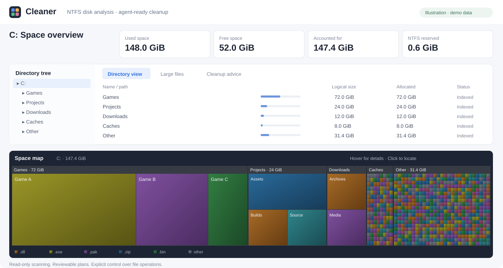

# Cleaner

**Scan in seconds. See what takes space. Build a clear cleanup plan.**

Cleaner is an AI-agent skill for Windows disk cleanup, combining fast NTFS scans, interactive treemaps, and reviewable cleanup plans. A native C++ engine reads the Master File Table (MFT); a local browser interface makes the results easy to explore; an agent helps decide what is worth acting on.



*Illustration with synthetic data. The current application interface is primarily Chinese.*

## Why use Cleaner?

### Get scan results in seconds

Spend your time deciding what to do with your files. Cleaner reads NTFS metadata directly instead of opening every directory and querying every file individually. Its native pipeline parses file records, resolves extension records, aggregates directory sizes, and writes a compact index.

A measured local run indexed **about 1.15 million files and 319,000 directories in 2.68 seconds**, including native index export. See [Performance](#performance) for the timing boundaries.

### See where the space goes

Explore a linked **directory tree, sortable file list, and nested treemap**. Larger items receive larger areas, file types have distinct colors, and hovering reveals a path and size. Click a tile to locate its file or folder; right-click to inspect it in File Explorer.

The viewer also provides file-name search and size/type filters for large archives, installers, videos, and disk images. It uses Canvas 2D and compact binary payloads, with no frontend build step.

### Turn disk usage into a practical plan

Ask for a result, such as:

> Use $cleaner to analyze C: and prepare a plan to reach 30 GiB of free space. Do not delete anything yet.

Cleaner calculates the space gap, surfaces candidates, and lets the agent add reasons, evidence, and appropriate actions. Suggestions appear in the same interface as the scan results, so you can inspect the underlying files before making a decision.

The workflow is **scan and show first, then publish a first plan**. The skill gives the initial analysis an approximately three-minute budget; detailed investigations happen when requested. This is a planning target, not a guaranteed model response time.

### Keep control of each action

Select items across categories and pages, then review a deduplicated processing list. File operations use an explicit confirmation step and one-use execution tickets bound to the scan, plan, and live source identity.

Personal-file moves are verified before the original is removed. Permanent deletion is a separate, explicit choice. Software and managed games use system or launcher workflows rather than deleting installation folders.

### Understand the numbers

Cleaner distinguishes **logical size, allocated space, and NTFS reserved space**. Hard-linked file records are assigned to one canonical parent for physical accounting. Directory totals and treemap weights use the same allocation data.

Candidate size is not a promise of recovered space. The result of an operation is checked against actual free-space changes, and unresolved or unaccounted amounts remain visible rather than being silently assigned to a folder.

### Use it from an agent or a terminal

Cleaner includes a [Codex skill](SKILL.md), a JSON CLI, and versioned plan files. An agent can inspect a compact overview, publish or revise a plan, prepare a selection, and follow confirmed operations without inventing filesystem commands for each task.

Scanning and the viewer run locally. The viewer has no embedded model service; the agent you invoke performs the analysis using the metadata it reads. Scan results and runtime tokens are excluded from Git.

## Performance

One local Windows run on an approximately **200 GiB NTFS volume** produced:

| Measurement | Result |
| --- | ---: |
| File records indexed | 1,145,383 files + 319,238 directories |
| Native results ready | 2.38 s |
| Native scan including index export | **2.68 s** |
| Complete scan task, including authorization handling and viewer index loading | 11.86 s |
| Unresolved file sizes / parser errors in that run | 0 / 0 |

These measurements are from a live local volume and may benefit from the OS cache. They are not a cold-disk benchmark or a guarantee for every machine. Browser rendering, agent reasoning, and file copying have their own costs; they are not included in the native scanner timing.

The scanner's implementation and earlier measurements are documented in [PERFORMANCE.md](PERFORMANCE.md).

## Quick start

### Requirements

- Windows 10/11 with a **local NTFS** target volume.
- Python 3.12 is the tested runtime, plus NumPy.
- MSVC C++ Build Tools with C++20 support to compile the native scanner.
- Administrator approval to read raw NTFS metadata. The elevated reader is reused within a viewer session; file operations do not use that reader's elevated permissions.

From the repository directory:

```powershell
python -m pip install -r requirements.txt
.\native\build.cmd
python cleaner_cli.py doctor
python cleaner_cli.py scan --target 'C:\' --open
```

The scan command opens the local viewer by default. On the first run, the viewer opens as soon as the first scan is available. Later scans can show progress in the already-open interface. Use `--no-open` for a headless invocation.

To reopen the most recent result:

```powershell
python cleaner_cli.py start --open
```

The URL uses `127.0.0.1`, a local port, and a random access token. Keep the printed URL for the active session. Services started through the CLI default to an eight-hour idle timeout.

## Install as a Codex skill

Keep the repository on the drive of your choice and link it into your Codex skills directory. The example below assumes the repository is at `E:\Projects\cleaner` and that the destination does not already exist:

```powershell
New-Item -ItemType Junction `
  -Path "$env:USERPROFILE\.codex\skills\cleaner" `
  -Target 'E:\Projects\cleaner'
```

Then invoke `$cleaner`, for example:

> Use $cleaner to scan C: and show me the largest files and cleanup suggestions.

The repository contains the skill instructions and runtime; scan indexes, plans, and operation logs stay in its ignored `results/` directory.

## What can it do today?

| Capability | Current behavior |
| --- | --- |
| Disk analysis | Read-only MFT scans of local Windows NTFS volumes |
| Folder analysis | Scan the containing volume, then show the selected folder's scope |
| Visualization | Linked directory tree, file list, treemap, and large-file filters |
| Cleanup plans | Rule-discovered candidates refined by an agent; JSON import/export and live page updates |
| Personal-file deletion | Recycle Bin or explicitly confirmed permanent deletion |
| Personal-file moves | Same-volume rename or verified cross-volume copy followed by source removal |
| Installed software | Read installed-app metadata and hand off to Windows Settings for uninstall |
| Managed game moves | Hand off to the corresponding launcher workflow |
| Application caches | Identify candidates and recommend application-specific cleanup; no blanket cache-root deletion |

Uninstall and launcher handoffs are reported as **awaiting user action**, not as completed removals. The current scanner does not support non-NTFS volumes or network shares.

## Agent and CLI workflow

Get a compact overview with a free-space target:

```powershell
python cleaner_cli.py overview --goal-free-gib 30
```

The response includes the space gap, candidate identities, allowed actions, major allocations, and the first-plan analysis deadline. It reads the existing index rather than rescanning the drive.

Plans and execution previews are separate:

```text
Scan → visualize → publish a plan → select items → preview → confirm → act → verify
```

- [SKILL.md](SKILL.md): invocation, fast first-pass behavior, and decision criteria.
- [Plan schema](references/plan-schema.md): identity-bound agent recommendations.
- [Operation protocol](references/operations.md): previews, confirmation tickets, execution, and results.

## Data integrity and accounting

- Scanning does not change source files. Reports are written under `results/`.
- Cross-volume file copies preserve and verify named NTFS data streams as well as the main stream. Changed or actively written sources are not forcibly removed.
- Existing destinations are not overwritten. Links, whole Git projects/worktrees, system locations, and the running environment are excluded from generic file handling.
- Generic directory handling currently rejects directories with named data streams instead of silently dropping that data.
- Moving files into the same drive's Recycle Bin does not immediately free that space. Same-volume moves also do not increase the drive's free space.
- Hard-link attribution can make individual directory totals differ from tools that count every path separately. The scan is live metadata, not a point-in-time snapshot.
- After confirmed file changes, rescan to refresh the tree and check the actual free-space target.

## Development

Node.js is needed only for the JavaScript tests, not to run the viewer.

```powershell
python -m unittest discover -s . -p 'test_*.py'
node viewer/test_treemap.cjs
node viewer/test_live_workflow.cjs
.\native\build\cleaner-scan.exe --self-test
```

File-operation tests create their own temporary fixtures. Set `CLEANER_TEST_ROOT` to choose their test directory; use a location outside the repository and application-managed data directories.

More implementation notes: [VIEWER.md](VIEWER.md), [SIZES.md](SIZES.md), [BULK.md](BULK.md), and [READING.md](READING.md). Some engineering notes are currently in Chinese.

## Inspiration

Cleaner's visual exploration is inspired by disk analyzers such as [WizTree](https://www.diskanalyzer.com/). Its analysis-to-action workflow also draws on the [storage-analyzer skill](https://github.com/KKKKhazix/khazix-skills/blob/main/storage-analyzer/SKILL.md). Cleaner combines these ideas with its own native scan pipeline, agent-facing plans, and local file-operation checks.
